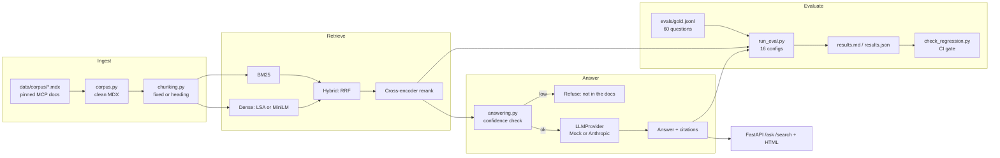

# RAG Eval Lab

A retrieval-augmented question answering system over the Model Context Protocol (MCP)
documentation, whose real product is its evaluation harness. It answers one question with
evidence: **which RAG design is actually better, by how much, and how do you know?** Sixteen
configurations (2 chunkers x 4 retrievers x reranker on/off) are scored on a 60-question gold set
with recall@k, MRR, nDCG, citation accuracy, refusal accuracy and faithfulness, compared with
paired bootstrap confidence intervals, and protected in CI by a recall@5 regression gate. It
builds, tests, evaluates and demos with zero API keys; a live Anthropic model is used only when
`ANTHROPIC_API_KEY` is set.


## Architecture



## Quickstart

```bash
pip install -e ".[dev,neural]"
python -m evals.run_eval
uvicorn rag_eval_lab.api:app
```

Then open http://localhost:8000. The first command installs the package with the local models
(tip: install CPU-only torch first with `pip install torch --index-url
https://download.pytorch.org/whl/cpu` to avoid a large CUDA download). The second runs the full
ablation in mock mode (about 8 minutes on a laptop CPU) and rewrites `evals/results.md`. The third
serves the winning configuration; set `RAG_CONFIG=heading/bm25` for an instant start without
models. Docker: `docker build -t rag-eval-lab . && docker run -p 8000:8000 rag-eval-lab`.

Checks: `ruff check .`, `mypy`, `pytest`, `python -m evals.check_regression`.

## Demo output

`POST /ask {"question": "How does a client cancel an in-flight request over stdio?"}` (mock
provider, hit list shortened to ids and reranker scores):

```json
{
  "config": "fixed/hybrid+rerank",
  "provider": "mock",
  "answer": "To cancel an in-flight request, the client **MUST** send a `notifications/cancelled` notification referencing the request's ID. [specification/basic/transports/stdio#f005] Each binding defines how a client abandons an in-flight request: on stdio the client sends a `notifications/cancelled` notification; on Streamable HTTP it closes the request's response stream. [specification/basic/transports/index#f003]",
  "citations": ["specification/basic/transports/stdio#f005", "specification/basic/transports/index#f003"],
  "refused": false,
  "confidence": 0.85,
  "hits": [
    {"chunk_id": "specification/basic/transports/stdio#f005", "score": 8.38},
    {"chunk_id": "specification/basic/transports/index#f003", "score": 8.2},
    {"chunk_id": "specification/basic/patterns/cancellation#f002", "score": 5.98},
    {"chunk_id": "specification/basic/patterns/cancellation#f001", "score": 5.51},
    {"chunk_id": "specification/basic/patterns/subscriptions#f006", "score": 4.68}
  ]
}
```

An out-of-scope question is refused before any LLM call:

```json
{"question": "How do I deploy an MCP server on Kubernetes with Helm?",
 "answer": "Not in the docs: I could not find this in the MCP documentation.",
 "refused": true, "confidence": 0.33, "citations": []}
```

## Eval results

Mock mode, 50 answerable + 10 unanswerable questions. R@5 is recall@5 in percent with a 95%
bootstrap interval; latency is retrieval time per query on the build machine's CPU. Full table,
paired comparisons, threshold sweep and analysis: [`evals/results.md`](evals/results.md).

| Config | R@5 (95% CI) | MRR | nDCG@10 | Citation acc | Refusal acc | ms/query |
| --- | --- | --- | --- | --- | --- | --- |
| fixed/hybrid+rerank | 89 (80 to 97) | 64.8 | 71.1 | 38.0 | 93.3 | 542 |
| heading/dense-lsa+rerank | 89 (80 to 96) | 65.2 | 72.2 | 37.5 | 88.3 | 988 |
| heading/bm25+rerank | 87 (77 to 96) | 64.7 | 70.9 | 35.4 | 88.3 | 1011 |
| heading/hybrid+rerank | 85 (75 to 94) | 65.2 | 72.6 | 41.7 | 90.0 | 964 |
| fixed/bm25+rerank | 83 (73 to 93) | 63.9 | 69.9 | 36.0 | 93.3 | 545 |
| fixed/dense-lsa+rerank | 83 (73 to 93) | 64.6 | 70.9 | 38.0 | 93.3 | 533 |
| fixed/dense-minilm+rerank | 81 (70 to 91) | 58.4 | 64.3 | 37.5 | 93.3 | 515 |
| heading/dense-minilm+rerank | 79 (67 to 89) | 60.7 | 66.7 | 37.2 | 91.7 | 973 |
| heading/hybrid | 79 (67 to 90) | 59.4 | 65.4 | 34.0 | 90.0 | 14 |
| fixed/bm25 | 77 (65 to 88) | 60.0 | 65.6 | 35.0 | 90.0 | 1 |
| heading/bm25 | 77 (65 to 88) | 57.3 | 63.3 | 34.7 | 88.3 | 1 |
| fixed/hybrid | 75 (63 to 86) | 57.0 | 62.7 | 34.4 | 90.0 | 14 |
| heading/dense-lsa | 73 (61 to 85) | 52.4 | 61.3 | 33.3 | 86.7 | 2 |
| heading/dense-minilm | 73 (61 to 85) | 57.6 | 63.3 | 44.4 | 88.3 | 13 |
| fixed/dense-lsa | 71 (58 to 83) | 52.8 | 59.4 | 37.2 | 85.0 | 2 |
| fixed/dense-minilm | 69 (56 to 81) | 45.8 | 51.2 | 33.3 | 83.3 | 12 |

What the numbers say:

- **Reranking is the change that matters**: +6 to +16 points of recall@5 for every first stage.
- **The top four are a tie.** Their differences (0 to 4 points) sit inside the paired bootstrap
  intervals. `fixed/hybrid+rerank` is served because it is tied for best and is the cheapest of
  the four to rerank.
- **BM25 beats a small general-purpose embedder** on protocol documentation full of identifiers,
  and hybrid retrieval pays off mainly as a better candidate pool for the reranker (candidate
  recall@20 of 96 to 98%).
- **Answer metrics are mock-mode numbers.** Citation accuracy reflects an extractive mock that
  quotes the two most word-overlapping sentences; faithfulness is 100% by construction for the
  same reason and is omitted here.

## Design decisions and trade-offs

- **Gold labels are evidence quotes, not chunk ids** ([ADR 0001](docs/adr/0001-evidence-quotes-as-gold-labels.md)).
  One gold file evaluates any chunking strategy; the cost is that each question credits only one
  labelled passage, so recall is a lower bound.
- **Exact numpy search, no vector database** ([ADR 0002](docs/adr/0002-brute-force-vector-search.md)).
  About 800 chunks need no approximate index; evaluation is not blurred by ANN recall loss.
- **A provider interface with a deterministic mock as the default** ([ADR 0003](docs/adr/0003-provider-interface-with-deterministic-mock.md)).
  Offline, reproducible CI; the price is that answer-quality numbers are only meaningful in live mode.
- **Refuse before generation from IDF-weighted term coverage** ([ADR 0004](docs/adr/0004-refuse-before-generation.md)).
  Retriever-independent and cheap, but blind to paraphrase and to on-topic unanswerable questions.
- **Serve hybrid + rerank, gate every config in CI** ([ADR 0005](docs/adr/0005-rerank-and-gate-every-config.md)).
  The reranker costs about half a second per query on a CPU; a 3-point tolerance absorbs model
  jitter but still catches a 2-question regression.
- **BM25 written by hand** (about 40 lines in `retrievers.py`) to keep the formula readable, and
  a vendored corpus snapshot (pinned commit, licence notice) so builds never depend on the network.
- Smaller decisions made along the way are logged in [`DECISIONS.md`](DECISIONS.md).

## Limitations

- **The gold set is small and author-written.** 60 questions written by the system's builder from
  the documents; they favour lexical matching. One question is 2 points of recall. See
  [`evals/GOLD.md`](evals/GOLD.md).
- **Single-source labels.** When another page also answers a question, a correct retrieval counts
  as a miss (2 of the winner's 6 misses are this).
- **The refusal threshold was tuned on the eval set**, and the confidence heuristic misses 4 of 10
  unanswerable questions that use only in-corpus vocabulary.
- **No live-mode results.** No API key was available while building, so answer quality and LLM-judge
  faithfulness were never measured live; the live path is covered by unit tests with a fake client.
- **MiniLM truncates** inputs at 256 word pieces, so the longest heading-aware chunks (up to 1500
  characters) are partly ignored by the dense retriever.
- **CPU latency.** Reranking takes about 0.5 to 1 second per query; indexes are rebuilt at startup.
- The Docker image is built in CI; it could not be built locally because Docker Hub rate-limited
  the build machine.

## What I'd do next

1. **Cache embeddings on disk** keyed by model and chunk text, so the API starts in seconds and
   the ablation stops re-embedding unchanged chunks.
2. **Contextual chunk headers**: prepend each chunk's heading path before indexing and measure it
   as a new ablation dimension.
3. **Stemming in the tokenizer**, then re-measure BM25 recall and the refusal sweep, since both
   depend on exact word matches.
4. **Reranker depth sweep** (10, 20, 40 candidates) to chart recall@5 against latency.
5. **Harder unanswerable questions** that use only in-corpus vocabulary, to stress the refusal policy.
6. **Multi-source gold labels** reviewed by a second annotator, and live-mode results with an
   API key (answers plus LLM-judge faithfulness).
